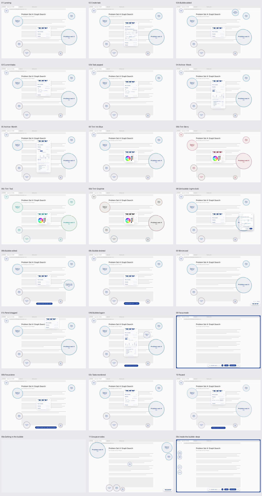
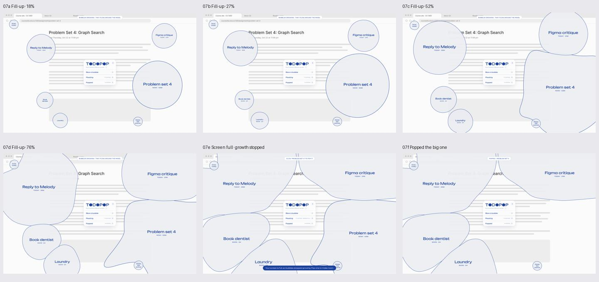

# TODOPOP：Figma 完整实现差距与开发步骤

> 后续规则已更新：以 [当前产品规则](product-decisions.zh-CN.md) 为准。Step 与 Focus 计时条已移出范围，保留自动 URL Focus；点击按有无链接区分。本文其余审查内容保留为原设计与代码基线的对照。

> 审查日期：2026-10-23（America/New_York）  
> 代码基线：`c9804cf`，沿用现有 Electron + React + TypeScript + Chrome Extension 实现。  
> 设计来源：[TODOPOP prototype · 11:2](https://www.figma.com/design/51bGy6oFsJV6YJa9jvBKIT/TODOPOP?node-id=11-2)。  
> 范围确认：用户明确要求「手机端先不做」。本轮只规划桌面端；手机设计只作审查记录，不进入开发步骤、工期或验收。  
> 本文是审查与后续开发方案，不代表下面列出的缺失功能已经实现。

## 1. 结论

现有工程可以继续作为桌面完整版的基础，不需要推倒重写。任务管理、原生透明窗口、拖动、本地保存、Chrome 上下文识别和认证通信都已经存在。

但当前版本仍然是原 technical plan 范围内的 MVP，**不能视为完整复现了这份 Figma**。主要差距集中在：

1. 气泡随时间增长、彼此挤让、绕开面板、屏幕满后停止增长。
2. 全局暂停增长，以及暂停、专注、休眠、离线之间的时间规则。
3. 完整专注体验：入场动画、隐藏面板、屏幕边框、计时条、完成/退出和步骤气泡。
4. 自定义分组、主题色、分组颜色与侧边位置、Shuffle / Line up、任务排序。
5. 周/月归档、真实历史统计、专注时长、再次生成任务时保留历史。
6. 最小化 Launcher、设计中的快捷键、独立编辑浮层、成功提示与删除撤销。

手机 Remote 已查看，但按本次范围确认暂不实现。

**技术可行不等于当前已经符合。** 桌面部分大多能在现有技术栈上补齐；复杂气泡布局需要新增引擎和性能验证。当前不需要为了桌面完整版引入账号、云端服务或手机同步。原计划排除的完整统计，如今出现在桌面归档设计中，应按本次桌面范围补齐；手机继续排除。

## 2. 本次看了哪些内容

本次读取了两个页面：`brainstorm`（0:1）和 `TODOPOP prototype`（11:2），检查画布结构、说明文字、隐藏图层、透明度和原型 reactions，并查看了 43 个 frame 的截图。

| 设计区域             | 审查范围                                            | 如何理解                                                                                     |
| -------------------- | --------------------------------------------------- | -------------------------------------------------------------------------------------------- |
| App screens          | 24 个桌面画面                                       | 核心业务与桌面交互                                                                           |
| Fill-up flow         | 6 个画面，18% → 27% → 52% → 76% → Screen full → Pop | 增长、占屏与恢复空间的演示                                                                   |
| Phone remote（暂缓） | 已查看 3 个 390 × 844 画面                          | 仅保留审查记录；按用户要求不纳入实现                                                         |
| Components           | 组件库及 2 个示例 frame                             | Bubble、Urgency、Logo、Accordion、Task row、Edit、Launcher、Focus bar、Group color picker 等 |
| Type specimens       | 4 个字体方案                                        | 设计比较稿，不应默认全部实现成可切换主题                                                     |
| Caption type options | 4 个 caption 方案                                   | 同样需要先选定生产版本                                                                       |
| brainstorm           | 草图与基本字段                                      | 补充背景；没有读取到正式 flow 起点                                                           |

Prototype 页有两个正式 flow 起点：**TODOPOP**（14:3）与 **Fill-up demo**（68:4066）。Phone remote 有画面，但未读取到独立 flow 起点，部分连线仍指向桌面 frame。

截图与图层要结合判断：例如 Focus mode 中普通气泡和 Panel 的 `visible=true`，但 `opacity=0`，实际应隐藏；不能因为图层仍存在就把它当成可见内容。审查期间也观察到部分组件文字更新，因此本文以本次读取的画面为准，落地前仍应冻结一个设计版本。

## 3. 当前符合与不符合的地方

状态含义：**已具备**指核心能力存在；**部分符合**指已有类似功能但语义、外观或覆盖范围不足；**缺失**指没有对应实现；**需决策**指设计与现有方案有冲突或缺少规则。

| 编号 | Figma 要求                                                           | 当前情况                                                      | 判断与下一步                                                                                               |
| ---- | -------------------------------------------------------------------- | ------------------------------------------------------------- | ---------------------------------------------------------------------------------------------------------- |
| F01  | Landing、三个折叠区、任务计数                                        | `Landing.tsx` 已实现                                          | **部分符合**：保留结构；对齐最终尺寸、颜色、浮层和反馈。设计样例中的固定计数不能直接照抄。                 |
| F02  | 创建任务、四级 urgency、选择 group                                   | `TaskForm.tsx`、`UrgencyPicker.tsx` 已实现                    | **部分符合**：缺 `+ New` / `Edit groups`；已有 URL 输入是技术方案补充，需确定在最终设计中的位置。          |
| F03  | 独立、透明、置顶、可拖动的气泡                                       | `BubbleWindows` 已实现，位置本地保存                          | **已具备基础能力**：复杂布局、巨大气泡与多显示器仍需扩展和实测。                                           |
| F04  | 四种基础大小                                                         | 窗口大小 118 / 192 / 298 / 446                                | **已具备初始尺寸**，并非随时间增长。窗口尺寸还包含透明留白，不等于可见气泡直径。                           |
| F05  | Idle A/B、Hover、Pop、Gone 状态                                      | 已有慢浮动、弹性缩放、完成爆裂                                | **部分符合**：当前没有按每个 variant 精确还原轮廓与时序；缺暂停虚线和专注过渡。                            |
| F06  | 放着不做会变大，显示等待时间/直径                                    | 仅按 urgency 选择固定尺寸与素材                               | **缺失**：新增增长时钟、尺寸函数、计时元数据和持久化。                                                     |
| F07  | 气泡相互挤让、绕开 Panel                                             | 位置由索引公式产生或手动拖动                                  | **缺失**：新增共享布局/碰撞计算；不是加一个 CSS scale 就能完成。                                           |
| F08  | Screen full 时停止增长，Pop 后腾出空间                               | 无占用率或容量状态                                            | **缺失**：定义“满”的判据与恢复机制。                                                                       |
| F09  | 30 min / 1 hour / Till tomorrow / Until I resume 暂停增长            | 现有 snooze 隐藏单任务 10 分钟                                | **不符合设计语义**：全局暂停时气泡应留在屏幕上、停止增长并显示暂停状态；snooze 可保留为独立能力。          |
| F10  | 点击气泡 Pop；进入专注有单独入口                                     | 当前普通点击打开 URL，✓ 完成                                  | **需决策**：与原 technical plan 的 click-to-open 冲突。先确认最终映射，再统一鼠标、键盘和文案。            |
| F11  | 右键/点击任务名编辑，Save / Cancel / Delete                          | 功能已存在                                                    | **部分符合**：现在编辑区接在主面板下面；设计是靠近气泡的独立 popover。                                     |
| F12  | 更新/删除/完成/再次生成的 toast；Delete 可 Undo                      | 只有状态更新，删除直接过滤任务                                | **缺失**：增加通知和可撤销删除，不能用“恢复已完成任务”代替 Undo delete。                                   |
| F13  | 列表 grip 拖动排序，方向键也能排序                                   | grip 是图片，实际按 urgency 排序                              | **缺失**：增加持久化 rank、拖动与键盘操作，取消每次渲染强制 urgency 排序。                                 |
| F14  | Arrange：Shuffle、Line up 四个方向                                   | 没有对应命令或控件                                            | **缺失**：接入布局引擎，保证不覆盖面板/Launcher，不破坏分组约束。                                          |
| F15  | 最小化后右下角 Launcher、⌘⇧Space                                     | 关闭面板后靠 Dock/菜单恢复                                    | **部分符合**：没有 Launcher；现有 `CmdOrCtrl+Shift+T` 是菜单 accelerator，不是设计中的全局快捷键。         |
| F16  | Panel 可拖动                                                         | 标题区域有原生 drag region                                    | **已具备拖动基础**：没有保存主面板位置，也没有把它作为布局避让区。                                         |
| F17  | 自动识别工作上下文                                                   | Chrome 扩展、URL matcher、localhost WebSocket 已实现          | **已具备**：限 Chrome、有效配对和匹配 URL；这部分可直接复用。                                              |
| F18  | Get in the bubble 可主动进入完整专注体验                             | 当前按钮只打开已有 URL                                        | **部分符合**：不是主动 session；无 URL 的任务也没有独立专注入口。                                          |
| F19  | 入场 skin 动画；隐藏普通气泡与 Panel                                 | 当前只隐藏普通气泡                                            | **部分符合**：面板仍在；缺入场动画、退出还原和独立窗口编排。                                               |
| F20  | Focus bar、计时、边框、Done / ×                                      | 当前主面板只有状态文字                                        | **缺失**：新增 Focus session、Focus bar 与穿透边框；Done 完成、× 不完成。                                  |
| F21  | 专注期间其它气泡暂停增长；记录时长                                   | 当前没有增长和 session 记录                                   | **缺失**：与增长时钟和历史事件一起实现，避免藏起来仍继续长大。                                             |
| F22  | + Step、步骤侧边切换、步骤气泡                                       | Task 没有 steps                                               | **缺失**：新增步骤数据、输入、完成状态、侧边布局与动画规则。                                               |
| F23  | 自定义 group、右键颜色选择器                                         | 固定 None / School / Work / Life                              | **部分符合**：已有分组字段，但没有可编辑分组实体、增删改、菜单或颜色设置。                                 |
| F24  | 按 group 决定颜色、侧边位置；未分组自由漂浮                          | 行内 dot 用 group 色；桌面 body 却按 urgency 选择固定彩色 SVG | **不符合颜色语义**：urgency 应控制大小/增长，group 控制分组视觉和布局；两者需解耦。                        |
| F25  | 6 个随 Tint 变化的组色；选中占用色会交换；自定义颜色保持             | 无 palette 或颜色来源信息                                     | **缺失**：记录 palette slot / custom 来源，定义交换与变色规则。                                            |
| F26  | Ink Blue / Berry / Teal / Graphite、自定义 Tint；点击 Logo 的 O 打开 | 硬编码蓝色；Logo 的 O 是静态图片                              | **缺失**：增加设置、主题 token 与 picker；O 的 16% 弹性 hover 也尚未实现。                                 |
| F27  | Popped 的 Week / Month、日期导航、每日列表、统计                     | 只有按 completedAt 排序的列表                                 | **部分符合**：只满足基础归档；没有日历、周柱图、最佳日、专注时长和按日筛选。                               |
| F28  | Re-bubble 保留过去完成记录                                           | restore 把原任务改为未完成并清除 completedAt                  | **部分符合且数据不够**：新版必须先保留历史事件/任务轮次，否则历史统计会被恢复操作抹掉。                    |
| F29  | Phone remote                                                         | 设计已查看，现有工程无跨设备层                                | **暂缓，不计入本轮缺口验收**：不增加手机应用、账号、云服务和离线同步。                                     |
| F30  | 面向普通用户直接下载安装                                             | 只有开发/本地构建命令                                         | **尚未交付**：有 electron-builder 依赖，没有可分发安装包和完整发布配置。不是设计画面本身，但影响最终使用。 |

### 三个不能混为一谈的概念

- **暂停增长 ≠ 隐藏任务**：Figma 的 Paused 仍显示带暂停样式的气泡；当前 snooze 会移除窗口。
- **自动 Focus 判定 ≠ 完整 Focus session**：现有 `NORMAL / FOCUS` 只决定普通气泡显隐，没有任务归属、计时、步骤和主动退出语义。
- **恢复一个任务 ≠ 重建完整历史**：只存当前状态无法解释多次完成、再次生成、专注退出和删除撤销。

## 4. 哪些条件现在具备，哪些需要补齐

| 条件                                   | 现在是否具备                | 对完整实现的影响                                                                                                       |
| -------------------------------------- | --------------------------- | ---------------------------------------------------------------------------------------------------------------------- |
| Electron 原生透明、置顶窗口与受限 IPC  | 是                          | 继续复用；新增 Launcher、Focus bar、popover、步骤窗口，不绕过现有权限检查。                                            |
| React、Motion、Zustand 与本地字体/素材 | 是                          | 可承接 UI；需要统一 tokens 和参数化气泡几何，不能继续复制固定 SVG 颜色当主题系统。                                     |
| Chrome 当前页面、前后台和断线事件      | 是，需要加载扩展与配对      | 自动进入/离开工作上下文已有来源；非 Chrome、桌面任意应用内容识别不在当前能力范围。                                     |
| 本地任务可靠写入、损坏备份             | 是                          | 能保存新版状态；必须扩展 schema 和迁移，不能只在 TypeScript 中加字段。当前 load 会逐字段重建，未接入的新字段会被丢掉。 |
| 任务时间与历史数据                     | 只有 createdAt、completedAt | 不足以计算暂停后的有效增长时长、每次 Focus session、再次完成记录与周/月历史。                                          |
| 动态布局与软体形变引擎                 | 否                          | 满屏挤压是本项目技术风险最高的桌面部分，需要独立验证。                                                                 |
| 统一模式/可见性协调器                  | 否                          | 手动 Focus、自动 URL Focus、全局 Pause、单任务 Snooze 和 Screen full 需要协调，不能堆独立 boolean。                    |
| 运行时任务云服务/用户账号              | 桌面版不需要                | 保留本地 JSON 与 localhost Chrome bridge 即可；手机同步已排除。                                                        |
| 最终交互规则与视觉基准                 | 不完全                      | Figma 包含候选字体、过时组件描述、演示连线与实际功能冲突，先冻结决策再编码。                                           |
| 覆盖完整版的测试                       | 否                          | 已有测试只覆盖现有 MVP；不能据此承诺新增 flow 都可靠。                                                                 |

## 5. 开发前必须确认的规则

以下是建议，不是已经确认的产品需求。

| 决策                                    | 已读取的证据 / 当前冲突                                                                                                                        | 建议如何落地                                                                                                                                               |
| --------------------------------------- | ---------------------------------------------------------------------------------------------------------------------------------------------- | ---------------------------------------------------------------------------------------------------------------------------------------------------------- |
| D1：普通点击做什么？                    | Bubble 描述与 Fill-up 的 07e→07f 是点击 Pop；原技术方案和当前代码是点击打开 URL。                                                              | 如果目标是完整 Figma，普通点击 Pop，编辑层的 Get in the bubble 进入专注；若保留 click-to-open，需要同步修改 Figma、文案和验收标准。                        |
| D2：手动 Focus 与自动 Focus 谁优先？    | Figma 有 Get in / ×；当前 URL 一匹配就自动 FOCUS。                                                                                             | 区分 manual / automatic session。手动 × 退出后，在同一页面上不能下一秒又自动进入；可规定直到 URL/任务变化再允许自动重入。无 URL 任务也应允许手动 session。 |
| D3：操作 TODOPOP 自己是否会退出 Focus？ | + Step 输入、计时条操作可能使 Chrome 失去前台。                                                                                                | 自己的短暂编辑窗口不应被当成“分心”；需有会话归属/短暂交互规则，不能直接照搬当前 chromeFocused=false 即退出。                                               |
| D4：增长如何计时？                      | 文案有“约每 2 分钟长 1 cm”，Fill-up 连线却每 1.6 秒跳阶段。                                                                                    | 1.6 秒是原型演示节奏，不是正式增长速度。确认四级曲线、暂停是否补算、睡眠/退出期间是否增长、改 urgency / Re-bubble 是否重置。                               |
| D5：“cm”和满屏如何定义？                | 列表有直径 cm，画面有 18/27/52/76% 和 Screen full，但无完整算法。                                                                              | 用明确的逻辑像素/布局单位计算；如必须显示物理 cm，需另做显示器校准。满屏按扣除保护区后的可用空间/可行布局定义，避免把重叠面积重复计数。                    |
| D6：暂停、Snooze、Screen full 的恢复    | Figma 有全局四档暂停；代码只有单任务 10 分钟隐藏。                                                                                             | 作为不同动作。全局暂停保持可见；Resume 结束暂停，不清掉 Focus；Screen full 腾出空间后是否立即继续增长需明确。                                              |
| D7：步骤完成与侧边运动                  | 已有 + Step、Step side、四个步骤和“沿左侧各自保持高度平移”的说明，缺完整增删改/完成连线。                                                      | 先定义 steps CRUD、排序、完成后行为、父任务完成是否自动完成子步骤、切边的锚点与不重叠约束。                                                                |
| D8：Re-bubble 是恢复还是新一轮？        | Figma 的历史与 Again 同时存在；代码清除原 completedAt。                                                                                        | 推荐保留完成事件，生成新任务轮次或新的任务 ID，记录 sourceTaskId；不能擦除过去统计。                                                                       |
| D9：主题、组色与组名                    | 预设有 School / Work / Life，侧边示例又有 School / Jobs / Chores；组色说明提到占用色交换。                                                     | 组名是可编辑数据，使用稳定 groupId。明确 tint→palette 映射、默认 slot、占用色交换及 custom 色保持规则。                                                    |
| D10：颜色与字体以哪个稿为准？           | Logo 描述写 Comfortaa Bold，但实际文字节点为 Unbounded Regular；自定义色描述仍提 hue-only，当前画面已出现 Saturation 条；字体区有 8 份比较稿。 | 以冻结后的实际节点/画面为视觉基准，更新过时描述；不要把所有候选稿做成用户设置。确认自定义 Tint 与组色的 hue/saturation 取值边界。                          |
| D11：手机范围                           | 用户已明确「手机端先不做」。                                                                                                                   | 本轮已决定排除，无需为此阻塞桌面开发；以后重新立项时再定义同步架构。                                                                                       |

补充：部分样例画面在任务删除/完成后仍保留旧计数，历史也标有 sample history。实现必须根据真实数据派生计数和统计，不能把这些数字视为业务规则。`09a Getting in the bubble` 的独立截图近乎空白，但其图层和 0.05 秒后跳转仍存在，应作为过渡帧结合前后状态验证，而非实现一个空白屏。

## 6. 沿用当前工程的实现步骤

### 步骤 0：冻结设计与行为契约

产物：确认尚未确定的 D1–D10，标注正式字体、主题、状态、交互入口和未补全连线。把 30 个桌面业务画面（24 个 App screens + 6 个 Fill-up）转成可验收场景；不把 3 个手机画面、字体候选稿或浏览器占位背景计入必做页面。D11 的手机范围已确定排除。

验收：每个入口有动作，每个动作有结果；明确“和 Figma 一致”及“因技术方案保留的差异”。

### 步骤 1：升级数据模型与命令层

复用 `packages/shared`、`TaskRepository`、现有 IPC / WebSocket 认证。先增加版本化迁移和命令接口，再做界面。

建议新增：

| 数据                          | 必要字段/信息                                             | 用途                                                     |
| ----------------------------- | --------------------------------------------------------- | -------------------------------------------------------- |
| AppState                      | schemaVersion、tasks、groups、settings、sessions/history  | 不再只保存 Task 数组；兼容现有 tasks.json。              |
| Task                          | groupId、rank、增长累计时长、轮次/sourceTaskId、steps     | 增长、排序、分组、步骤、再次生成。                       |
| Group                         | id、name、paletteSlot 或 customColor、preferredSide       | 名称不做 enum；颜色与位置独立可配。                      |
| Growth clock                  | accumulatedEligibleMs、runningSince、暂停区间/原因        | 只累计允许增长的时间，不用 Date.now-createdAt 简单替代。 |
| Focus session                 | taskId、source、startedAt、endedAt、有效时长、结束原因    | 支持手动/自动、Done/leave、归档统计。                    |
| Task event / completion cycle | eventId、taskId、kind、timestamp、必要快照                | 保留重复完成/删除/撤销历史；统计不依赖当前 completedAt。 |
| Settings                      | tint、palette、自定义色、全局暂停策略、布局设置、面板位置 | 跨窗口一致，重启后保留。                                 |

修改点：`types.ts`、`validation.ts`、`storage.ts`、`preload.ts`、`main.ts`。把 mutation 提取成可测试的领域命令，桌面 UI 共用；继续验证调用窗口和载荷。现有 40 个未完成 / 1000 个总任务限制也需评估是否符合最终历史保留策略。

验收：旧任务无损迁移；重启保留新增字段；历史不会被 Restore 覆盖；失败写入不造成半份新状态；过期窗口事件仍安全忽略。

### 步骤 2：实现增长与全局暂停

新增共享 `growthEngine` 与可注入时钟。将“初始尺寸”与“当前可见尺寸”分开，由 urgency 和有效等待时间推导。主进程维护统一时间源，动画帧只负责平滑呈现；不要每帧写 JSON，也不要每个任务创建互不协调的计时器。

暂停来源分别记录：用户全局 Pause、当前 Focus、Screen full、单任务 Snooze。`Till tomorrow` 按用户本地日界线恢复；`Until I resume` 保留显式状态。设计的 Paused 用虚线/弱化显示，当前 Snooze 保留独立隐藏语义。

同步改 `Bubble.tsx` 的固定 geo、文字宽度、命中区和 `windowManager.ts` 的窗口尺寸。只放大 BrowserWindow 不会放大当前固定坐标的图案；只放大图案又会被旧窗口裁切。

验收：用虚拟时间验证不同级别、暂停恢复、睡眠/重启边界、修改 urgency、Snooze 到期；等待时间和直径展示取自同一模型。先做到规则正确，再对齐 Fill-up 的形变。

### 步骤 3：实现布局、挤让与满屏停止

新增共享 `layoutEngine`：输入显示器 workArea、Panel/Launcher/Focus bar 保护区、气泡几何、group preferredSide 和用户拖动约束；输出每个任务的位置、大小、必要轮廓与容量状态。

分两层交付：先做不会覆盖控件、不会越界、稳定不抖动的分散/靠边排列；再做与 Fill-up 一致的软体挤压和绕行。可先复用每任务一个 BrowserWindow 的方案，但每个窗口只画自己的结果，不能各自独立算碰撞。

巨大气泡需要验证显存、窗口更新开销、边缘裁切和鼠标命中。若另做全屏视觉层，它必须默认穿透，交互区域另行管理；不能直接用一个拦截整块桌面的窗口替代现有方案。是否换渲染方式应由真实性能原型决定。

验收：重现 07a–07f 的空间变化；面板始终可操作；满屏停止增长；完成一个任务后腾出空间；多显示器和分辨率变化后可找回任务。百分比是参考状态，不是四张固定图片。

### 步骤 4：实现完整 Focus 与 Steps

复用 URL matcher / 扩展事件，但增加 session controller；窗口管理器统一协调普通气泡、Panel、Launcher、Focus bar、步骤和屏幕边框。

顺序：Get in / 自动匹配 → 进入动画 → 隐藏普通气泡和 Panel → 显示计时条/边框 → 可增改步骤 → Done 完成并落历史，或 × 退出但不完成 → 恢复正确窗口与增长状态。

步骤需要独立数据和展示层；复用 Bubble 外形/动画而不是把它们当普通顶层任务。侧边切换保留各自纵向锚点，按注释直线平移，不把所有步骤叠到一个角。新增输入浮层需要临时可聚焦，同时避免让自动 Focus 将 TODOPOP 自己的操作误判为离开工作。

验收：无 URL 也能手动专注；同 URL 多任务有明确 session 归属；手动退出不循环重入；Done 与 × 统计不同；全局 Pause 与 Focus 组合不会错误恢复；步骤可重启恢复。

### 步骤 5：实现分组、主题、排序与桌面操作

增加 Groups 管理、右键 picker、6 色 slot 与交换、自定义 hue/saturation、Tint 设置及 Logo O 的交互。当前固定颜色 SVG 需更新为能表达最终主题的素材/参数化渲染，不要用滤镜近似替代设计颜色。

把 groupId、group color 与 urgency 解耦：分组决定细环/颜色和 preferredSide，urgency 决定尺寸/增长。组名支持编辑；删除组时明确定义任务移到 No group 还是选择目标组。

加入 rank 排序和键盘操作，再接 Shuffle / 四边 Line up / 每组 preferredSide。新增 Launcher、全局快捷键和面板位置持久化。Launcher 自身不要照搬面板 Logo 的 hover 放大，设计注释明确它保持普通状态。

验收：改 Tint 后所有原生窗口同步；custom 组色保持；占用 palette 色按规则交换；拖动排序重启不变；排序与空间排列互不误改；面板最小化后始终可恢复。

### 步骤 6：实现归档、撤销与视觉收口

用真实 event/session 数据生成 Week / Month、日期导航、每日列表、总数、最佳日和专注时长。当前日期、用户时区、跨午夜和空状态都要处理；不导入 Figma 样例数据冒充用户历史。

Re-bubble 复用旧内容生成新一轮，过去完成记录仍保留。Delete 先保留可撤销记录/快照，再提供 Undo toast；不是从数组永久过滤后才补一个按钮。

把当前面板下方的编辑区改为独立 popover，贴近目标气泡并在边缘翻转/夹取位置。补全创建、更新、删除、完成和 Again 的反馈；核对最终字体、浅色气泡、分组细环、透明度、Logo hover、数字字号与动效。

验收：清空/完成/恢复/删除/撤销在任务列表、气泡、图表和统计中一致；用最终设计快照逐状态比对，而非只对齐 Landing。

### 步骤 7：发布与完整验收

开发可直接继续本地运行。面向普通用户时，再补应用图标、electron-builder 配置、`.app` / `.dmg`、升级与数据路径验证，以及目标分发渠道需要的签名/发布步骤；Chrome 扩展也需要正式安装说明或相应分发流程。

验收应同时包含领域逻辑、真实原生窗口、Chrome 扩展、视觉快照和多显示器手工测试，不能只以 `npm run build` 成功为准。

## 7. 推荐实施顺序与风险

| 顺序 | 可交付结果                                       | 依赖                | 风险                             |
| ---- | ------------------------------------------------ | ------------------- | -------------------------------- |
| 0    | 冻结桌面行为、视觉；记录手机暂缓                 | 产品/设计确认       | 中：不确认会反复重做             |
| 1    | 版本化数据、命令、历史与 session 基础            | 步骤 0              | 中：旧数据迁移                   |
| 2    | 可计时增长、全局 Pause、基本布局/Screen full     | 步骤 1              | 高：复杂形变单独做技术原型       |
| 3    | 完整 Focus bar、边框、Done/leave、Steps          | 步骤 1–2            | 高：多窗口与自动/手动语义        |
| 4    | Groups、Tint、组色、侧边、排序/Arrange、Launcher | 数据与布局基础      | 中：跨窗口一致性；部分 UI 可并行 |
| 5    | 周/月历史、Again、Undo、编辑 popover、视觉对齐   | 历史/session 已完成 | 中                               |
| 6    | 打包、桌面完整验收与分发                         | 前面验收完成        | 中：目标机器/渠道验证            |

这不是再加几个按钮即可结束的改动。若仍以最初 48 小时 Hackathon 为边界，建议先交付“增长 + 暂停 + Focus + Steps”的桌面主闭环，再补颜色、布局、归档与发布。手机不参与本轮排期，本文不据此给出未经验证的工期承诺。

## 8. 验收清单与当前证据

| 验收主题       | 需要证明的行为                                                     | 当前证据                                                                                     |
| -------------- | ------------------------------------------------------------------ | -------------------------------------------------------------------------------------------- |
| 当前 MVP 基础  | CRUD、四尺寸、原生拖动与保存、配对、Chrome URL Focus、Snooze、恢复 | 已有 `scripts/e2e.mjs` 与 `docs/e2e-result.json`；最近记录通过，rendererErrors 为空。        |
| 增长与 Pause   | 可控时间、所有暂停组合、睡眠/重启、Screen full                     | 无对应实现与完整测试。                                                                       |
| Focus / Steps  | 主动进入、计时、Done/×、自己窗口不误退出、steps 操作               | 现有自动隐藏测试不能覆盖。                                                                   |
| 主题/分组/布局 | 换 Tint、颜色交换、custom 保持、各边排列与冲突                     | 无完整实现与测试。                                                                           |
| 归档           | 跨日/周/月、重复完成、Again、Undo、统计不丢失                      | 现有恢复测试只覆盖旧语义。                                                                   |
| 手机（排除）   | 本轮无手机验收要求                                                 | 不做实现，也不作为桌面交付未通过的理由。                                                     |
| 原生质量       | 多屏拔插、Spaces、巨型气泡命中、popover 边缘、窗口生命周期         | 仍需场景化手工与性能验证；此前已出现并修复过过期窗口事件异常，不能因一次通过就视为全部可靠。 |
| 视觉一致性     | 30 个桌面业务画面与相关组件的正式状态                              | 当前测试检查了素材加载与代表截图，不是全 Figma 像素/行为验收。                               |

本次是设计与静态实现审查，查阅了已有测试结果，没有为这份文档重新运行全部 GUI 测试，也没有把计划中的能力写进业务代码。

## 9. 可复用代码与建议新增模块

以下路径相对于仓库根目录。

| 现有文件/模块                                            | 继续复用的部分                 | 需要扩展/拆分                                                           |
| -------------------------------------------------------- | ------------------------------ | ----------------------------------------------------------------------- |
| `packages/shared/types.ts`、`validation.ts`              | 任务、上下文、输入校验         | Group 实体、Steps、History、Session、Settings、命令与版本               |
| `focusEngine.ts`、`urlMatcher.ts`                        | Chrome URL 匹配与正常/专注判定 | 从单纯显隐判定中分离 session 生命周期、手动退出与策略                   |
| `apps/desktop/electron/storage.ts`                       | 串行写入、原子替换、恢复备份   | 版本化 AppState、旧数据迁移、历史追加与留存策略                         |
| `electron/main.ts`、`preload.ts`                         | 原生入口、授权、窄 IPC         | 提取 CommandService / SessionController；增设新窗口的权限范围           |
| `electron/windowManager.ts`                              | 透明置顶窗口、拖动、指针穿透   | 统一窗口编排、动态 geometry、保护区、LayoutEngine 输出                  |
| `electron/websocketServer.ts`、`apps/chrome-extension/*` | 本机认证、上下文、重连         | 保持 Chrome bridge 职责；保持 localhost 访问边界                        |
| `src/components/Bubble.tsx`                              | 通用外形、指针交互、动画结构   | 连续尺寸、group 视觉、等待信息、Paused、Steps、精确 variants            |
| `TaskForm.tsx`、`TaskList.tsx`、`Landing.tsx`            | 表单、折叠区、列表和反馈入口   | Groups、rank、Archive、Theme、popover、Launcher；按桌面职责拆分控制面板 |
| `src/styles.css`、本地 Figma 素材                        | 初始视觉基础                   | 生产 tokens、动态色与状态，不再全局固定一个蓝色方案                     |
| `scripts/e2e.mjs`、shared tests                          | 现有测试基础                   | 新模式组合、虚拟时钟、历史、视觉和多显示器测试                          |

建议新增的模块名称只是规划：`growthEngine`、`layoutEngine`、`sessionController`、`historyService`、`commandService`、`FocusBar`、`StepBubble`、`Launcher`、`ArchiveView`、`GroupManager`、`TintPicker`、`ControlPanel`。本轮不新增 `apps/remote`、跨设备 transport、账号或云服务。

### 关键代码核查入口

- [任务与模式模型](/Users/xiaoxiao/Documents/Codex/2026-10-22/cr-ea/outputs/todopop/packages/shared/types.ts:1)：目前只有 NORMAL/FOCUS、固定 group enum 与基本任务字段。
- [固定气泡尺寸与颜色](/Users/xiaoxiao/Documents/Codex/2026-10-22/cr-ea/outputs/todopop/apps/desktop/src/components/Bubble.tsx:12)：body 和 geo 按 urgency 选择，未使用 groupId 或增长时间。
- [实际排序](/Users/xiaoxiao/Documents/Codex/2026-10-22/cr-ea/outputs/todopop/apps/desktop/src/components/TaskList.tsx:28)：当前强制按 urgency 排序；grip 尚无排序逻辑。
- [Focus 判定](/Users/xiaoxiao/Documents/Codex/2026-10-22/cr-ea/outputs/todopop/packages/shared/focusEngine.ts:3)：当前是 URL + 前台的显隐判定，不是 session controller。
- [恢复/删除/Snooze 语义](/Users/xiaoxiao/Documents/Codex/2026-10-22/cr-ea/outputs/todopop/apps/desktop/electron/main.ts:148)：删除过滤、恢复清除 completedAt、Snooze 隐藏 10 分钟。
- [本地加载与写入](/Users/xiaoxiao/Documents/Codex/2026-10-22/cr-ea/outputs/todopop/apps/desktop/electron/storage.ts:9)：新字段须显式接入 load 与迁移。
- [原生窗口与边界](/Users/xiaoxiao/Documents/Codex/2026-10-22/cr-ea/outputs/todopop/apps/desktop/electron/windowManager.ts:27)：现有窗口同步、固定尺寸、位置夹取与可见性。
- [主面板与编辑区](/Users/xiaoxiao/Documents/Codex/2026-10-22/cr-ea/outputs/todopop/apps/desktop/src/pages/Landing.tsx:44)：无 Launcher/Archive 日历；编辑区位于面板下方。
- [已有联调结果](/Users/xiaoxiao/Documents/Codex/2026-10-22/cr-ea/outputs/todopop/docs/e2e-result.json:1)：仅作为当前 MVP 的历史验证证据。

## 10. 产品最后通过什么形式上线

### 推荐：macOS 下载版 App + Chrome Web Store 扩展

对当前 TODOPOP，最自然的公开发布形态是两件配套产品：

- **TODOPOP.app**：真正的桌面程序，放进 `.dmg` 安装镜像中供用户下载；用户安装后双击打开，不再需要 Node.js、源码、`npm run dev` 或持续打开终端。
- **TODOPOP Chrome Extension**：从 Chrome Web Store 安装，用于自动识别匹配的工作网页。基础任务、增长、手动专注应可独立使用；自动 URL Focus 需要扩展和本机配对。

下载网站只负责产品介绍、安装包、版本说明、帮助和隐私政策；桌面任务仍可只保存在本机。**公开提供下载不等于把产品改成云端服务。** 手机端不做，也就不需要为本轮增加跨设备账号与云同步。

这是基于现有 Electron 原生窗口与 Chrome bridge 的发布建议，不是已经完成的上线配置。

| 阶段                     | 实际给用户什么                                   | 需要完成什么                                                                                            | 当前状态                                                    |
| ------------------------ | ------------------------------------------------ | ------------------------------------------------------------------------------------------------------- | ----------------------------------------------------------- |
| 开发/队内演示            | 源码 + `npm run dev`；扩展 Load unpacked         | 当前开发环境                                                                                            | 已具备。适合开发，不适合作为普通用户安装流程。              |
| 小范围桌面内测           | 版本化 `.app` / `.dmg`，清晰的扩展安装与配对说明 | 应用图标、打包配置、干净机器启动测试、版本/架构标识、反馈渠道；签名/公证应进入内测发布准备              | 尚未生成安装包。                                            |
| 正式公开发布（优先路线） | 下载页上的签名/公证 `.dmg` + 商店扩展链接        | Apple Developer ID 签名、公证及票据随包分发、发布构建、扩展商店资料与审核、配对引导、隐私说明、更新策略 | 需要新增发布工程与相关开发者账号/凭据。                     |
| 未来 Mac App Store       | App Store 内安装的 TODOPOP                       | 单独验证 MAS 构建、App Sandbox/entitlements、签名、商店审核，以及本地服务/置顶窗口/Chrome 配套流程      | 不作为首发承诺，也不能把现有 `.dmg` 直接当作 MAS 构建提交。 |
| 纯网站 / PWA             | 浏览器内的任务面板                               | 可以承接展示或控制面板，但无法仅靠当前网页替代应用级桌面悬浮窗口                                        | 不适合作为本轮桌面产品的主要交付形式。                      |

站外 macOS 发布应安排代码签名与 notarization。签名和公证并不等同于 Mac App Store 的 App Review；公证是 Apple 对分发软件进行自动检查的流程。相关条件以 [Electron 签名指南](https://www.electronjs.org/docs/latest/tutorial/code-signing) 和 [Apple 分发说明](https://developer.apple.com/documentation/technologyoverviews/distribution?changes=latest_major) 为准。

### 正式发布前的具体步骤

1. **固定发布身份和产物**：配置 productName、稳定 appId / bundle ID、版本号、图标和数据目录；沿用当前用户数据并验证升级迁移。区分 Apple Silicon / Intel 产物，或验证 universal 包；不能因为在当前 Mac 能启动就宣称所有 Mac 均支持。
2. **使用工程已有的 electron-builder 补打包配置**：先验证产物确实包含 main、preload、renderer 和运行依赖，再生成 `.app` / `.dmg`。当前依赖为 v26 系列，配置应查对应版本，不能直接照抄 v27 文档的重命名字段。[electron-builder v26 macOS 配置](https://www.electron.build/v26/docs/mac/)
3. **签名、公证与安装验证**：使用发布凭据完成签名、公证和必要票据处理；凭据只放开发者机器或 CI 的秘密配置中。用未装 Node.js、未拉源码的干净 Mac 测试下载、安装、首次打开、卸载和重装，不把关闭系统安全保护当作正式用户流程。
4. **发布 Chrome 扩展**：准备构建 ZIP、图标、截图、单一用途说明、各权限用途、隐私披露和安装后的配对引导；提交 Chrome Web Store。商店上传和审核有独立流程，不是把 dist 文件夹放到下载站即可。[Chrome 发布流程](https://developer.chrome.com/docs/webstore/publish)、[隐私与权限说明](https://developer.chrome.com/docs/webstore/cws-dashboard-privacy)
5. **区分内测和公开可见性**：扩展可以选择 Private、Unlisted 或 Public；Unlisted 不是私密授权，知道链接的人仍可安装，而且这些可见性都需要经过相同政策审核。[Chrome 分发设置](https://developer.chrome.com/docs/webstore/cws-dashboard-distribution)
6. **补产品级安装引导**：首次启动解释“App 负责气泡、扩展负责识别 Chrome”；提供商店入口、连接状态、配对、断线重试、端口冲突和重置配对说明。当前已存在的状态与手动配对可继续复用，但安装版需要消除让用户寻找源码目录的步骤。
7. **建立下载与维护入口**：可用产品官网承载介绍/帮助，用可靠的文件托管或版本 Release 承载安装包。若使用 GitHub Releases，需要先建立相应远端仓库与发布流程——当前仓库还没有 remote。网站或 Release 托管不意味着上传用户任务。
8. **定义升级策略**：首版可先提供清晰的手动检查更新与新版下载；若实现自动更新，再补签名验证、更新元数据、旧数据兼容和失败恢复。当前工程没有自动更新实现，不能仅在 UI 上放一个按钮就算完成。

如果将来选择 Mac App Store，需要额外评估 App Sandbox 与商店构建限制。Electron 官方提供 MAS 分发路线，因此不能说 Electron 上不了架；但这条路线需要专项验证，不能保证当前全部桌面交互和扩展配对流程无需改动就能通过。[Electron MAS 指南](https://www.electronjs.org/docs/latest/tutorial/mac-app-store-submission-guide)

**最终用户的理想流程：下载 TODOPOP.dmg → 安装到 Applications → 打开 App → 按需安装 Chrome 扩展并配对 → 直接使用。** 不要求用户配置开发环境，也不要求为了桌面功能注册云端账号。

## 附录 A：完整 frame 追踪表

以下列出本次截图审查的全部 43 个 frame。浏览器背景只是设计占位，不要求 TODOPOP 实现一个浏览器。字体候选稿仅用于确认设计，不默认计入用户功能。

| 区域                 | Figma frame                                                                                                              | 节点       | 对应差距/步骤                         |
| -------------------- | ------------------------------------------------------------------------------------------------------------------------ | ---------- | ------------------------------------- |
| Components           | [Hover states](https://www.figma.com/design/51bGy6oFsJV6YJa9jvBKIT/TODOPOP?node-id=77-4374)                              | `77:4374`  | F25 / F26；步骤 5 / 6                 |
| Components           | [Group color picker · custom hue](https://www.figma.com/design/51bGy6oFsJV6YJa9jvBKIT/TODOPOP?node-id=95-4381)           | `95:4381`  | F25 / F26；步骤 5 / 6                 |
| App screens          | [01 Landing](https://www.figma.com/design/51bGy6oFsJV6YJa9jvBKIT/TODOPOP?node-id=14-3)                                   | `14:3`     | F01 / F03 / F05；步骤 6               |
| App screens          | [02 Create task](https://www.figma.com/design/51bGy6oFsJV6YJa9jvBKIT/TODOPOP?node-id=15-244)                             | `15:244`   | F02 / F23；步骤 1 / 5                 |
| App screens          | [02b Bubble added](https://www.figma.com/design/51bGy6oFsJV6YJa9jvBKIT/TODOPOP?node-id=15-531)                           | `15:531`   | F02 / F23；步骤 1 / 5                 |
| App screens          | [03 Current tasks](https://www.figma.com/design/51bGy6oFsJV6YJa9jvBKIT/TODOPOP?node-id=15-925)                           | `15:925`   | F09 / F13 / F14；步骤 2 / 5           |
| App screens          | [03b Task popped](https://www.figma.com/design/51bGy6oFsJV6YJa9jvBKIT/TODOPOP?node-id=15-1251)                           | `15:1251`  | F05 / F12 / F27；步骤 6               |
| App screens          | [04 Archive · Week](https://www.figma.com/design/51bGy6oFsJV6YJa9jvBKIT/TODOPOP?node-id=15-1691)                         | `15:1691`  | F27 / F28；步骤 1 / 6                 |
| App screens          | [05 Archive · Month](https://www.figma.com/design/51bGy6oFsJV6YJa9jvBKIT/TODOPOP?node-id=15-1961)                        | `15:1961`  | F27 / F28；步骤 1 / 6                 |
| App screens          | [06 Tint · Ink Blue](https://www.figma.com/design/51bGy6oFsJV6YJa9jvBKIT/TODOPOP?node-id=15-2231)                        | `15:2231`  | F25 / F26；步骤 5                     |
| App screens          | [06b Tint · Berry](https://www.figma.com/design/51bGy6oFsJV6YJa9jvBKIT/TODOPOP?node-id=15-2501)                          | `15:2501`  | F25 / F26；步骤 5                     |
| App screens          | [06c Tint · Teal](https://www.figma.com/design/51bGy6oFsJV6YJa9jvBKIT/TODOPOP?node-id=15-2771)                           | `15:2771`  | F25 / F26；步骤 5                     |
| App screens          | [06d Tint · Graphite](https://www.figma.com/design/51bGy6oFsJV6YJa9jvBKIT/TODOPOP?node-id=15-3041)                       | `15:3041`  | F25 / F26；步骤 5                     |
| App screens          | [08 Edit bubble (right-click)](https://www.figma.com/design/51bGy6oFsJV6YJa9jvBKIT/TODOPOP?node-id=25-2140)              | `25:2140`  | F10–F12；步骤 0 / 6                   |
| App screens          | [08b Bubble edited](https://www.figma.com/design/51bGy6oFsJV6YJa9jvBKIT/TODOPOP?node-id=25-2409)                         | `25:2409`  | F10–F12；步骤 0 / 6                   |
| App screens          | [08c Bubble deleted](https://www.figma.com/design/51bGy6oFsJV6YJa9jvBKIT/TODOPOP?node-id=25-2749)                        | `25:2749`  | F10–F12；步骤 0 / 6                   |
| App screens          | [00 Minimized](https://www.figma.com/design/51bGy6oFsJV6YJa9jvBKIT/TODOPOP?node-id=31-3086)                              | `31:3086`  | F15 / F16；步骤 3 / 5                 |
| App screens          | [01c Panel dragged](https://www.figma.com/design/51bGy6oFsJV6YJa9jvBKIT/TODOPOP?node-id=31-3375)                         | `31:3375`  | F15 / F16；步骤 3 / 5                 |
| App screens          | [04b Bubbled again](https://www.figma.com/design/51bGy6oFsJV6YJa9jvBKIT/TODOPOP?node-id=31-3655)                         | `31:3655`  | F27 / F28；步骤 1 / 6                 |
| App screens          | [09 Focus mode](https://www.figma.com/design/51bGy6oFsJV6YJa9jvBKIT/TODOPOP?node-id=37-3434)                             | `37:3434`  | F18–F22；步骤 4                       |
| App screens          | [09b Focus done](https://www.figma.com/design/51bGy6oFsJV6YJa9jvBKIT/TODOPOP?node-id=37-3813)                            | `37:3813`  | F18–F22；步骤 4                       |
| App screens          | [03c Tasks reordered](https://www.figma.com/design/51bGy6oFsJV6YJa9jvBKIT/TODOPOP?node-id=51-3732)                       | `51:3732`  | F09 / F13 / F14；步骤 2 / 5           |
| App screens          | [10 Paused](https://www.figma.com/design/51bGy6oFsJV6YJa9jvBKIT/TODOPOP?node-id=68-7213)                                 | `68:7213`  | F09；步骤 2                           |
| App screens          | [09a Getting in the bubble](https://www.figma.com/design/51bGy6oFsJV6YJa9jvBKIT/TODOPOP?node-id=87-4194)                 | `87:4194`  | F18–F22；步骤 4                       |
| App screens          | [11 Groups on sides](https://www.figma.com/design/51bGy6oFsJV6YJa9jvBKIT/TODOPOP?node-id=99-4423)                        | `99:4423`  | F14 / F24；步骤 3 / 5                 |
| App screens          | [09c Inside the bubble · steps](https://www.figma.com/design/51bGy6oFsJV6YJa9jvBKIT/TODOPOP?node-id=102-4265)            | `102:4265` | F18–F22；步骤 4                       |
| Type specimens       | [A · Unbounded + DM Sans + Space Mono](https://www.figma.com/design/51bGy6oFsJV6YJa9jvBKIT/TODOPOP?node-id=41-3677)      | `41:3677`  | D10；步骤 0 / 6：选定最终字体，不全做 |
| Type specimens       | [B · Fredoka + Outfit](https://www.figma.com/design/51bGy6oFsJV6YJa9jvBKIT/TODOPOP?node-id=41-3767)                      | `41:3767`  | D10；步骤 0 / 6：选定最终字体，不全做 |
| Type specimens       | [C · Syncopate + Figtree](https://www.figma.com/design/51bGy6oFsJV6YJa9jvBKIT/TODOPOP?node-id=41-3857)                   | `41:3857`  | D10；步骤 0 / 6：选定最终字体，不全做 |
| Type specimens       | [D · Nunito + Lexend](https://www.figma.com/design/51bGy6oFsJV6YJa9jvBKIT/TODOPOP?node-id=41-3947)                       | `41:3947`  | D10；步骤 0 / 6：选定最终字体，不全做 |
| Caption type options | [Caption 1 · DM Sans Medium, tracked caps](https://www.figma.com/design/51bGy6oFsJV6YJa9jvBKIT/TODOPOP?node-id=46-3677)  | `46:3677`  | D10；步骤 0 / 6：选定最终字体，不全做 |
| Caption type options | [Caption 2 · Unbounded Regular, small caps](https://www.figma.com/design/51bGy6oFsJV6YJa9jvBKIT/TODOPOP?node-id=46-3790) | `46:3790`  | D10；步骤 0 / 6：选定最终字体，不全做 |
| Caption type options | [Caption 3 · DM Mono Regular](https://www.figma.com/design/51bGy6oFsJV6YJa9jvBKIT/TODOPOP?node-id=46-3903)               | `46:3903`  | D10；步骤 0 / 6：选定最终字体，不全做 |
| Caption type options | [Caption 4 · Lexend Exa Regular](https://www.figma.com/design/51bGy6oFsJV6YJa9jvBKIT/TODOPOP?node-id=46-4016)            | `46:4016`  | D10；步骤 0 / 6：选定最终字体，不全做 |
| Fill-up flow         | [07a Fill-up · 18%](https://www.figma.com/design/51bGy6oFsJV6YJa9jvBKIT/TODOPOP?node-id=68-4066)                         | `68:4066`  | F06–F08；步骤 2 / 3                   |
| Fill-up flow         | [07b Fill-up · 27%](https://www.figma.com/design/51bGy6oFsJV6YJa9jvBKIT/TODOPOP?node-id=68-4506)                         | `68:4506`  | F06–F08；步骤 2 / 3                   |
| Fill-up flow         | [07c Fill-up · 52%](https://www.figma.com/design/51bGy6oFsJV6YJa9jvBKIT/TODOPOP?node-id=68-4948)                         | `68:4948`  | F06–F08；步骤 2 / 3                   |
| Fill-up flow         | [07d Fill-up · 76%](https://www.figma.com/design/51bGy6oFsJV6YJa9jvBKIT/TODOPOP?node-id=68-5390)                         | `68:5390`  | F06–F08；步骤 2 / 3                   |
| Fill-up flow         | [07e Screen full · growth stopped](https://www.figma.com/design/51bGy6oFsJV6YJa9jvBKIT/TODOPOP?node-id=68-5832)          | `68:5832`  | F06–F08；步骤 2 / 3                   |
| Fill-up flow         | [07f Popped the big one](https://www.figma.com/design/51bGy6oFsJV6YJa9jvBKIT/TODOPOP?node-id=68-6276)                    | `68:6276`  | F06–F08；步骤 2 / 3                   |
| Phone remote         | [R1 Remote · Blow a bubble](https://www.figma.com/design/51bGy6oFsJV6YJa9jvBKIT/TODOPOP?node-id=99-4838)                 | `99:4838`  | F29；已审查，按用户要求暂缓           |
| Phone remote         | [R2 Remote · Floating](https://www.figma.com/design/51bGy6oFsJV6YJa9jvBKIT/TODOPOP?node-id=99-5130)                      | `99:5130`  | F29；已审查，按用户要求暂缓           |
| Phone remote         | [R3 Remote · Popped](https://www.figma.com/design/51bGy6oFsJV6YJa9jvBKIT/TODOPOP?node-id=99-5403)                        | `99:5403`  | F29；已审查，按用户要求暂缓           |

## 附录 B：原型连线中已确认的核心路径

- `14:3 Landing → 15:244 Create → 15:531 Bubble added`：新增任务。
- `Landing → 15:925 Current tasks`，另有 `51:3732 Tasks reordered`：列表管理与排序。
- `25:2140 Edit → 25:2409 Edited / 25:2749 Deleted → Undo → Landing`：编辑、删除和撤销。
- `25:2140 Get in → 87:4194 Getting in → 37:3434 Focus → 37:3813 Done`；Leave 返回 Landing：专注生命周期。
- `102:4265 Inside the bubble · steps`：步骤的目标画面，不能把未完整连线的 + Step/切边当成已定义全部细节。
- `15:925 → 68:7213 Paused → Resume → 15:925`：全局暂停；画面提供四档，但明确连线主要演示 1 hour。
- `15:1691 Week ↔ 15:1961 Month`；Week 的 Again → `31:3655`：归档与再次生成。
- Logo 的 O → `15:2231 Tint`，四种 Tint frame 之间切换：主题。
- Close panel → `31:3086 Minimized`；Launcher → Landing；Brand drag → `31:3375`：桌面面板控制。
- `68:4066 → 68:4506 → 68:4948 → 68:5390 → 68:5832`：每次原型 timeout 约 1.6 秒；最后点击大气泡 → `68:6276 → 15:1251`。
- `99:4423 Groups on sides`：分组空间布局；组 picker 同时提供 any / left / top / bottom / right。
- Remote R1 / R2 / R3 已查看；部分交互跳到桌面 frame。按用户要求暂缓，仅作设计范围记录，不补手机连线或开发同步服务。

部分交互存在于组件变体中（Idle/hover/pop 的 CHANGE_TO），部分是跨 frame 的 NAVIGATE。原型的 E 键打开编辑，是 Figma 缺少真实右键触发的演示替代，不应因此替换桌面应用的真实右键。

## 附录 C：桌面设计总览截图

截图来自本次 Figma 读取，用作审查参考，不是当前应用已实现效果。

### App screens：24 个桌面状态

### Fill-up：增长到满屏的 6 个状态

