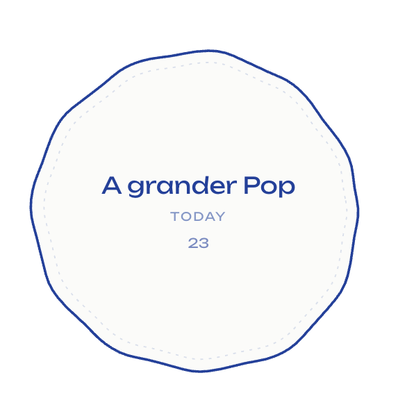

# TODOPOP 0.4.0：长按蓄力 Pop

日期：2026-10-23。本次用户反馈优先于旧文档中的双击编辑、右键 Pop 规则。

## 当前交互

| 操作                      | 行为                                             |
| ------------------------- | ------------------------------------------------ |
| 快速单击                  | 有 URL 打开链接，无 URL 进入本地 Focus billboard |
| 右键 / F2                 | 编辑名称、URL、紧急程度与分组                    |
| 持续按住约 0.85 秒        | 蓄力、放大、扭曲、抖动后 Pop                     |
| 拖动超过 6 CSS px         | 取消蓄力，移动气泡                               |
| Esc / 指针取消 / 窗口失焦 | 取消蓄力，不完成、不导航                         |

双击不再绑定完成或编辑动作；连续两次快速点击不会重复打开链接。快速单击不再等待旧版 350ms 双击判断。按住超过 250ms 但未达到 Pop 阈值就松开，会回弹并保留任务，也不会误打开链接；快速点击仍正常进入任务。

## 更大的视觉反馈

- 长按形变直接作用于实际膜轮廓、内圈与命中区域，包含逐渐增强的放大、波纹和抖动。
- 蓄力的目标放大为原轮廓约 1.42 倍，文字轻微跟随放大；释放时平滑回弹。
- 爆开时继续放大并淡出，保留十枚轮廓液滴；液滴尺寸随气泡增大，扩散半径从 0.42 倍画布提高到 0.47 倍。
- Sizzling 只包含视觉效果，本轮没有增加声音。
- 系统开启“减少动态效果”时，关闭高频抖动并降低蓄力放大幅度；支持运行中切换。
- 临时蓄力不写入任务尺寸，也不计入正式 95% 增长覆盖率。屏幕边缘仍受实际屏幕边界裁切。

## 教程与数据

首次打开新版会重新展示教程，练习“单击进入、右键编辑、长按 Pop”，只操作示例任务。主面板帮助入口可再次打开。真实任务、历史、分组和配色保留。Pop 后仍支持 Undo；任务列表和 Focus 中保留明确的完成操作，方便键盘使用。

## 验证

长按专项：`node scripts/hold-gesture.mjs`，结果见 [hold-gesture-result.json](hold-gesture-result.json)。覆盖实际鼠标按住过程中的放大/轮廓变化、提前释放、Esc、失焦取消边界、拖动取消、减少动态效果、单次完成和撤销。

桌面验收已更新为右键编辑与长按完成，并保留 Focus、URL、分组、草稿和重启恢复的回归。巨泡与 Chrome 端到端测试也使用长按。完整命令、状态与耗时见 [test-results/summary.json](test-results/summary.json)。测试使用临时数据目录。

## 人工复核

- [ ] 长按节奏是否舒服，0.85 秒是否合适。
- [ ] 快速单击进入任务，右键进入编辑；双击不误 Pop。
- [ ] 按住约半秒再松开，确认回弹、不导航、不完成。
- [ ] 一边拖动一边持续按住，不应完成。
- [ ] 检查放大、抖动和液滴扩散的力度，特别是小气泡、巨泡和屏幕边缘。
- [ ] 检查系统“减少动态效果”开关。

安装包为 Apple Silicon 本地预览，未通过 Apple 公证；安装前退出旧版。
