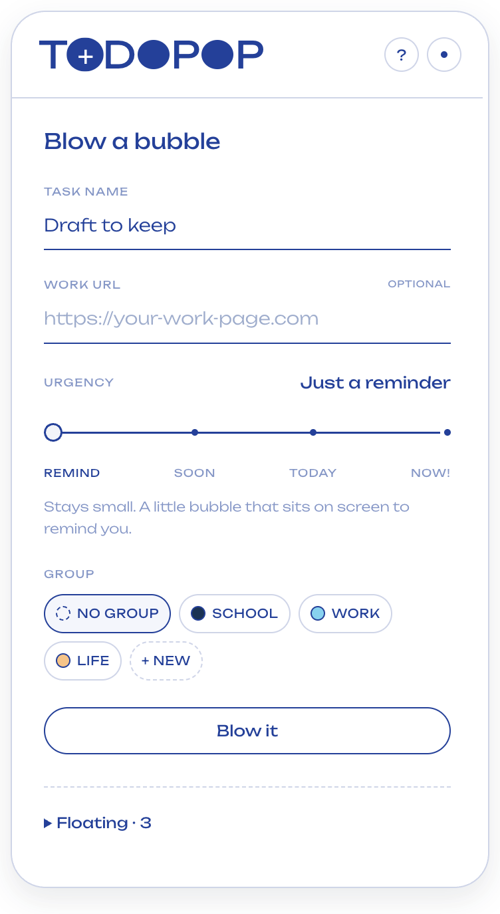
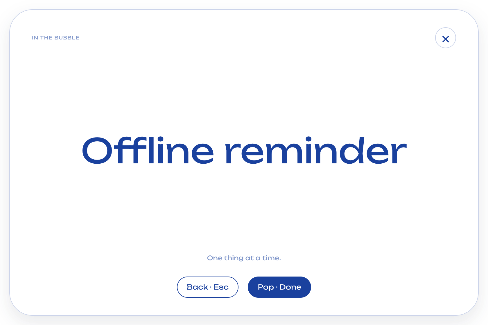
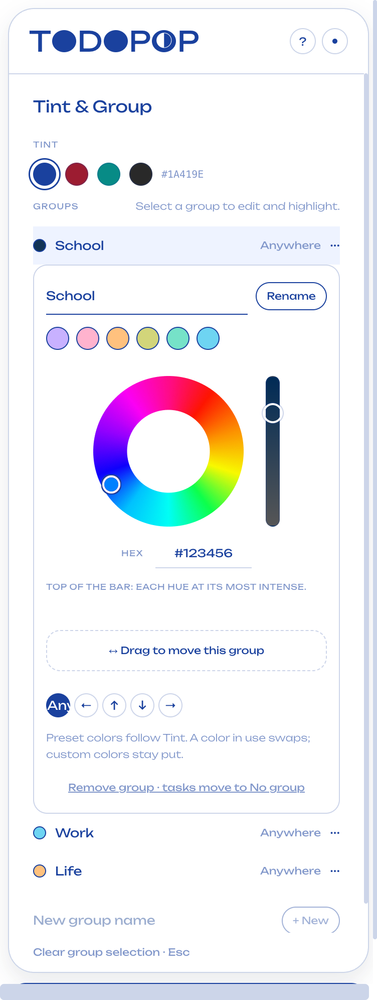

# TODOPOP 0.2.0 · 实施报告与人工复核

日期：2026-10-23。范围是本次确认的桌面交互与视觉方案。运行代码、教程、测试与预览打包配置均已更新；旧报告保留为历史记录。

## 已实现

| 模块       | 当前行为                                                                                                                                                  |
| ---------- | --------------------------------------------------------------------------------------------------------------------------------------------------------- |
| 三个 O     | 第一个 Blow a bubble；第二个 Popped；第三个 Tint & Group。一次显示对应的一块内容，非第三个入口同时展开三块。悬停或键盘聚焦显示符号，tooltip 提供名称。    |
| 固定控制条 | 固定在主屏工作区顶部中间，禁止拖动。展开内容在面板内滚动；菜单和 ⌘⇧Space 可找回。                                                                         |
| 单击       | 等待 350ms 区分双击；有链接打开 URL，无链接进入本地大字 billboard。无链接不再自动完成。                                                                   |
| 双击       | 只打开编辑层，不先触发单击。编辑名称、URL、紧急程度和分组，不新增备注字段。                                                                               |
| 右键       | 气泡表面右键 Pop；移除原来泡泡底下 Snooze、编辑、✓ 三个按钮。列表和 billboard 保留等价的完成操作。                                                        |
| Billboard  | 本地运行，不依赖 Chrome、URL 或网络。返回／Esc 不完成任务；Pop · Done 完成后退出。其他气泡暂藏，增长暂停。本地会话优先于浏览器自动 Focus。                |
| Pop 视觉   | 使用原 Figma 的描边水滴素材，十个方向散开，文字和主体隐去。教程使用同一效果组件。                                                                         |
| Squish     | 接触方向局部凹陷，带内外描边和弹性过渡；文字不跟轮廓挤压。绘制、命中区与覆盖计算共用轮廓点。                                                              |
| 95% 停长   | 计算可见轮廓的联合覆盖面积，重叠计一次，屏外裁切，排除菜单栏、Dock 与面板遮挡。达到 95% 全部停长，Pop 腾出空间后恢复。                                    |
| 巨泡可操作 | 原生窗口限制在工作区内，气泡在窗口内部裁切；避免 macOS 对超大窗口重新定位造成命中错位。可见表面仍能右键 Pop。                                             |
| 配色       | 原 Figma 的 150px 环形色盘、竖向饱和度条、预设与 HEX，支持鼠标和方向键。编辑分组时收起重复的全局色环。浅主题色自动使用较深的文字/描边色，选中色值仍保留。 |
| 分组       | 点击高亮本组、淡化其他组；专用手柄整组移动，保存成员位置和自由放置状态，重启保留。Line up / Shuffle 可恢复自动排列。删除组保留成员任务。                  |
| 恢复       | 新增撤销完成：恢复同一个任务和等待时长，移除对应完成记录。Re-bubble 仍是创建新一轮，两者不同。                                                            |
| 教程       | 首次出现，可跳过；? 随时重开。用临时气泡练习单击、双击、右键和返回，不修改真实任务。                                                                      |
| 旧数据     | 保留任务和历史；升级时清除旧 Pause 状态，避免旧用户隐性永久停长。Pause Growing 的 UI 与命令入口移除。                                                     |
| 日期与归档 | 气泡日期跟随当前日期刷新；任务不按天清空。完成收据内部滚动，继续支持周/月、日期筛选和新一轮 Re-bubble。                                                   |







## 验证结果

当前机器完整验证流程包含 9 项：类型检查、25 项共享逻辑测试、格式检查、生产构建、扩展 UI、桌面交互、巨泡/95%、30 泡负载、Electron + Chrome 端到端。详细结果以 [验证汇总](test-results/summary.json) 和对应日志为准。

- [桌面验收](desktop-acceptance-result.json)：教程、三个入口、固定窗口、billboard、单击/双击隔离、右键 Pop、快速 Undo、色环/饱和度/HEX、浅色文字保护、多个成员整组平移、位置锁定、重启保留和草稿恢复。
- [巨泡与面积验收](bubble-reachability-result.json)：实际达到 95% 后不继续累计增长；四边仍有可见右键命中面；Pop 后剩余任务恢复增长。
- [30 泡负载](layout-pressure-result.json)：30 个原生气泡窗口均加载，进入本地 Focus 时全部隐藏，返回时全部恢复，没有渲染异常。记录了 5 次状态快照耗时；这不是持续帧率或长时稳定性的证明。
- [Chrome 集成](e2e-result.json)：来源/配对码验证、真实 MV3 worker、导航、标签切换、前后台 Focus、断连恢复、数据持久化和损坏文件备份。检查 `nativeForegroundVerified` / `foregroundFixture` 字段判断这一轮是否使用边界替代；不要把替代测试冒充原生切换。
- [扩展界面](extension-ui-test.json)：独立连接窗口复用、配对、错误码、重连、断开、本地字体/Logo、主题和布局。

测试使用临时数据目录、一次性浏览器资料及隔离端口，不读取或修改用户的真实任务。正式预览包仍使用默认本地桥接端口。

## 视觉与工程边界

Squish 是基于接触方向的有限轮廓变形，使用既有 Motion 弹簧；不是完整的流体或体积守恒软体模拟。参考的是用户两泡接触截图与原始 Figma 的轮廓语言。需要人工复核接触深度、回弹速度及多泡密集时的手感。

覆盖率使用与渲染一致的 64 点轮廓，以及 1px 扫描线积分。它比原来的圆面积相加更符合设计，但属于数值近似，不是最终屏幕每个像素的读回统计；弹性过渡期间模型与显示存在短暂插值差异。

Figma 返回了 Popped 状态节点、十颗水滴和隐藏文字/主体的目标，但没有返回该节点的关键帧轨道。因此目前 480ms 的散开/淡出是本地过渡适配，不能声称时序已逐帧复刻。素材和来源见 [设计来源清单](design-sources.json)。

主要布局仍以主显示器为基准；外接屏、Spaces、Dock 变化和长时间运行需要人工复核。没有新增手机、后端、网站、声音、Step 或计时条。Chrome 连接为 Hackathon Demo 保留，billboard 独立工作；正式发行去掉扩展时也应明确取消当前依赖扩展的自动 URL 匹配能力。

## 安装与操作

1. 用 **⌘Q** 完全退出旧 TODOPOP。只关闭面板不会退出程序。
2. 打开 [0.2.0 Apple Silicon 预览安装包](../release/TODOPOP-0.2.0-arm64-preview.dmg)，替换 Applications 中的旧应用，然后启动。
3. 跟随首次教程，或点击字标右边的 ? 重开。
4. 不安装 Chrome 扩展也能创建任务、进入 billboard、编辑和 Pop。
5. 需要演示 URL 自动 Focus 时，再加载 [Chrome 扩展预览 ZIP](../release/TODOPOP-chrome-extension-preview.zip) 解压后的目录，点击桌面连接圆点复制代码并配对。

预览包仍只有本地 ad-hoc 签名，尚无 Developer ID 签名和 Apple 公证。没有安装自动更新，也没有提交商店。此轮不替换当前正在运行的用户应用。

## 人工复核清单

- [ ] 升级后旧任务、组色和完成历史都在，旧永久 Pause 不会继续阻止增长。
- [ ] 三个 O 的入口容易辨认，各开对应内容；小屏上新增、配色和收据都能滚动到末尾。
- [ ] 有链接气泡单击只打开网页；双击只编辑，不先开网页。无链接单击只进入 billboard。
- [ ] 右键 Pop 的十颗水滴效果符合 Figma 的视觉预期；没有三个底部按钮。误 Pop 可撤销，Re-bubble 则是新一轮。
- [ ] Billboard 大字与长中文标题可读；Esc／返回不完成，切到其他应用不误退，Chrome 断开不会关闭本地会话。
- [ ] 两泡接触轮廓与参考截图相近；拖拽时有局部挤压和回弹，文字不被拉扁，透明角落不会挡住其他应用。
- [ ] Demo 增长到 95% 后停长，右键 Pop 后继续；退出 Demo 回到正式增长，完成操作仍保留。
- [ ] 环形色盘、竖向饱和度、预设与 HEX 都能用；确认分组颜色与全局 Tint 不会意外互相覆盖。
- [ ] 选一组高亮，拖动手柄时多个成员一起移动；松手、重启不弹回。拖动中 Esc 可取消选择，不留下卡住的移动状态。
- [ ] 收据放入较多完成记录后能正常滚动，日期切换与跨午夜不清空未完成任务。
- [ ] 在外接屏、不同缩放、Dock 隐藏/显示、Spaces 和其他应用全屏场景中，核对控制条与气泡可达性。
- [ ] 日常放置 30 分钟以上，观察 CPU、回弹抖动和误触；30 泡的短测试不能替代这一项。

## 复现命令

```sh
npm ci
npm run verify
npm run package:mac
```

`verify` 默认使用临时数据与 17848 测试端口，并顺序执行各项检查。Mac 打包后的启动/创建/完成/退出另由 `scripts/package-smoke.mjs` 验证，结果见 `package-smoke-result.json`。
