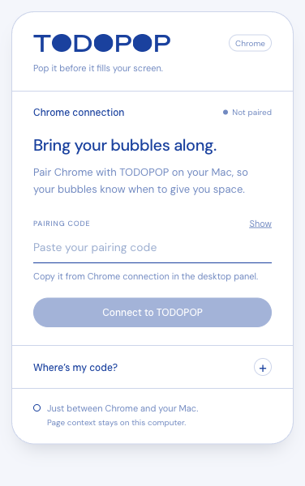
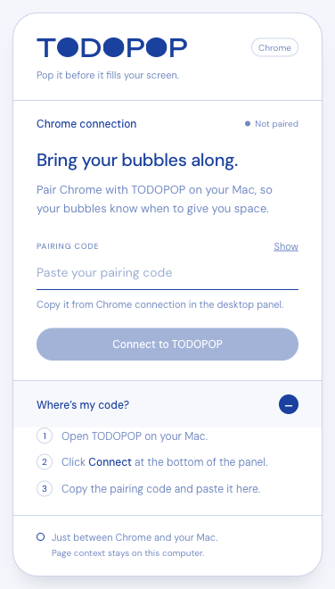

# TODOPOP 开发进度报告

日期：2026-10-23。范围以你最新确认的规则为准：手机、Step、Focus 计时条与音效不做；保留自动 URL Focus。

## 现在可以用到什么

本轮从扩展 UI 开始，继续完成了桌面主要功能闭环。**可以试用，但还不是正式公开发布版，也没有把 Figma 的软体挤压效果完整复现。**

| 模块                | 已完成内容                                                                                                   | 状态                             |
| ------------------- | ------------------------------------------------------------------------------------------------------------ | -------------------------------- |
| Chrome Extension UI | 与面板共享 Logo、DM Sans、蓝色方案、按钮、输入框和状态组件；有未配对、连接中、连接成功、断开、错误与帮助状态 | 完成                             |
| 输入框样式          | 取消你截图里的蓝色矩形 focus 框，只保留下划线与输入光标；桌面输入框同步                                      | 完成并专项测试                   |
| 本地数据            | 版本化 `state.json`；旧 `tasks.json` 自动迁移并先备份；存任务、分组、设置、完成历史与自动专注历史            | 完成                             |
| 点击规则            | 气泡有链接就打开 URL，无链接就 Pop；编辑浮层主按钮同样区分                                                   | 完成                             |
| 增长                | 四级基础大小、有效等待时长、正式速度和独立 Demo 预览                                                         | 完成基础逻辑                     |
| 全局暂停            | 30 min、1 hour、Till tomorrow、Until I resume、Resume；保持气泡可见，停止增长并显示暂停样式                  | 完成                             |
| 单任务 Snooze       | 隐藏单个任务 10 分钟；列表可点 Show now 提前恢复                                                             | 完成，与全局 Pause 分开          |
| 布局                | 圆形避让、面板保护区、四边排列、Shuffle、组的 preferred side；达到容量阈值暂停增长                           | 已实现可用近似                   |
| 自动 Focus          | Chrome 前台匹配工作 URL 就隐藏普通气泡和面板；离开/断开就恢复；保留既有本地认证与重连                        | 完成逻辑；真实系统切换请人工复核 |
| 分组/主题           | 新增、改名、删除组；六个预设色、占用色交换、自定义颜色保持；组侧边位置；四种 Tint 与自定义色                 | 功能完成；部分视觉采用简化控件   |
| 手动排序            | grip 拖动、方向键排序，rank 保存到本地                                                                       | 完成，键盘路径已自动验证         |
| 归档                | Week / Month、日期切换、完成数、最佳日、自动专注历史时长、每日完成列表                                       | 完成                             |
| Rebubble            | 新 ID、新一轮、等待与增长重置；原完成任务及历史保留                                                          | 完成                             |
| 编辑与 Undo         | 靠近目标气泡的独立编辑窗口，Save/Cancel/Delete；删除 toast 可撤销                                            | 完成                             |
| 最小化              | 右下角 Launcher、Dock/菜单恢复、注册 ⌘⇧Space；保存主面板位置                                                 | 完成；快捷键冲突需人工确认       |
| 未保存草稿          | 创建任务时切去管理分组，再回来保留当前草稿                                                                   | 完成                             |
| 本机安装产物        | Apple Silicon `.app` / `.dmg`，打包 App 的启动、创建任务、完成、退出冒烟测试                                 | 完成预览包；不等于正式签名发布   |

## 增长与 Demo 的具体规则

- 默认是 **Real speed**，使用正常计时。
- **Now!** 以每 2 分钟增加约 1 个“逻辑厘米”为基准，1 个逻辑厘米按约 37.8 px 处理；不是拿实体尺子在所有显示器上都能测到相同的厘米。
- Soon 为该速度的 1/4，Today 为 1/2，Remind 保持小尺寸。
- **Demo · 60×** 使用独立临时增长时钟，便于快速检查增长与满屏状态；不覆盖正式累计增长。
- 退出 Demo 会恢复正式尺寸。重启也默认回到 Real speed。Demo 只隔离增长；Pop/Delete 等任务操作仍会保存，建议用测试任务观察。
- 全局 Pause、自动 Focus、Screen full 停止增长；Snooze 停止对应任务增长。
- 程序退出或系统休眠期间不补算增长，避免回来后突然长满屏幕。增长定期保存，正常退出前会刷新；异常强退时最多可能损失最近一个保存周期的增长进度。

## 本轮解决的稳定性问题

1. 对过期/已销毁窗口的 IPC 继续保持防护，不把迟到鼠标事件变成主进程异常。
2. 完成、删除、编辑关闭和 Snooze 后的原生窗口生命周期分别处理。
3. 启动过程中立即退出，不再把已取消的异步窗口加载当成启动失败弹窗。
4. 正常退出先刷新状态，再结束进程，避免保存与关闭竞争。
5. 数据损坏保留恢复副本；不能读取的未来 schema 版本不会被当成当前版本直接覆盖。
6. 面板、Launcher、编辑浮层处于普通气泡之上的窗口层级，避免巨大气泡遮挡主要控制入口。

## 跳过或尚未完全还原的部分

| 项目                                   | 现在的处理                                                   | 为什么不把它算作完整完成                                                |
| -------------------------------------- | ------------------------------------------------------------ | ----------------------------------------------------------------------- |
| Figma 的软体挤压、非圆形贴边、精确绕行 | 当前为圆形碰撞/避让近似                                      | 没有实时软体轮廓求解器，不能宣称逐像素复现 Fill-up                      |
| Screen full 精确占屏率                 | 基于圆形面积与可用区域的容量近似                             | 不是完整计算屏幕裁切后形状并集，也不是 Figma 百分比的精确测量           |
| 自定义 Hue ring / Saturation 设计控件  | 使用系统原生颜色选择器完成颜色功能                           | 没有照搬 Figma 环形控件；主题中的 SVG 着色亦需最终视觉复核              |
| 真实 Mac 前台应用切换                  | 自动化验证了算法与消息链路，测试 Chromium 的系统激活存在限制 | 测试明确记录 foreground fixture，真实用户 Chrome / 应用切换必须手动核对 |
| 多屏、Spaces、性能和异常强退           | 有基础边界处理、容量限制和恢复保护                           | 未覆盖所有硬件、macOS 配置以及长时间运行                                |
| 正式 Apple 签名、公证、商店审核        | 已做本机 ad-hoc 预览包                                       | 缺正式发布凭据，不擅自上传或提交审核                                    |
| Intel / Windows / 其他浏览器           | 本轮不交付相应产物                                           | 目前只验证本机 Apple Silicon 路线                                       |
| 品牌 App 图标、自动更新                | 仍使用默认 Electron 应用图标；手动安装更新                   | 不算正式发布体验                                                        |

手机、Step、Focus 计时条、音效是你明确排除的项目，不计为本轮未完成。

## 现在怎么试

### 推荐：本机预览包

1. 打开 [TODOPOP Apple Silicon 预览 DMG](../release/TODOPOP-0.1.0-arm64-preview.dmg)，按安装窗口操作。
2. 或直接运行 [已打包的 TODOPOP.app](../release/mac-arm64/TODOPOP.app)。这是本机构建的预览产物，尚非 Developer ID 签名并公证的公开分发版。
3. 若用扩展：在 `chrome://extensions` 给已加载的 TODOPOP 点一次刷新。首次安装则 Load unpacked 选择 `apps/chrome-extension/dist`。
4. 扩展压缩包也在 [release/TODOPOP-chrome-extension-preview.zip](../release/TODOPOP-chrome-extension-preview.zip)，解压后可作为本地扩展目录加载。
5. Panel 底部 Connect → 复制配对码 → 扩展弹窗粘贴连接。全程无需用户云账号。

安装包限 Apple Silicon。若系统拒绝陌生来源的预览包，不要关闭系统安全保护；可继续使用当前开发目录，正式分发需补签名/公证。

### 继续使用源码

```sh
npm ci
npm run dev
```

完整检查先退出正在运行的 TODOPOP，避免占用本地 17846 端口，再执行：

```sh
npm run verify
```

## 你回来后先看这三份

- [人工复核清单](manual-review.zh-CN.md)：建议先做前 6 项，再看增长与布局细节。
- [测试详情与证据](testing-details.zh-CN.md)：区分逻辑测试、真实窗口/扩展测试、模拟边界及未验证项。
- [当前产品规则](product-decisions.zh-CN.md)：替代旧审查文档中尚未确认的行为。




