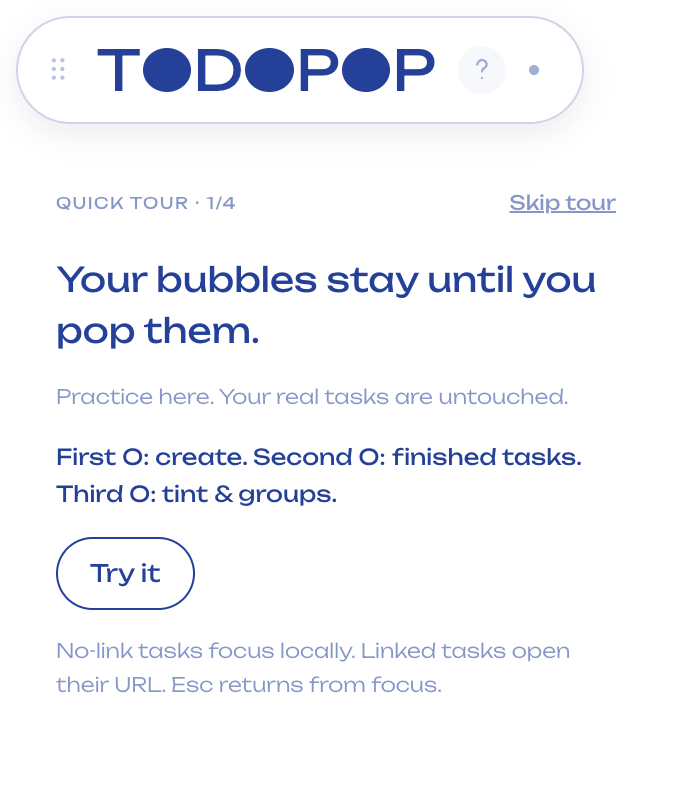
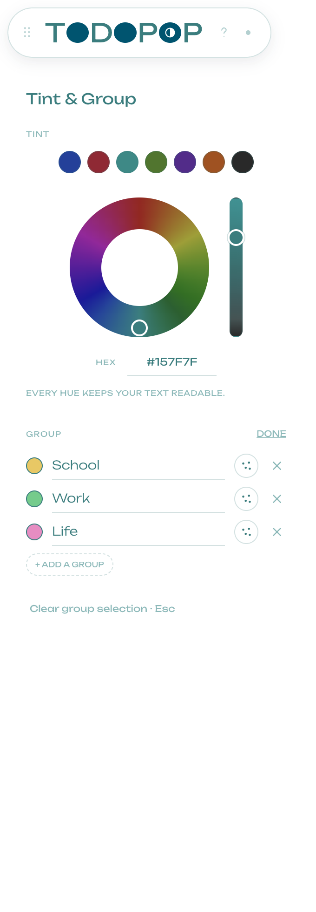
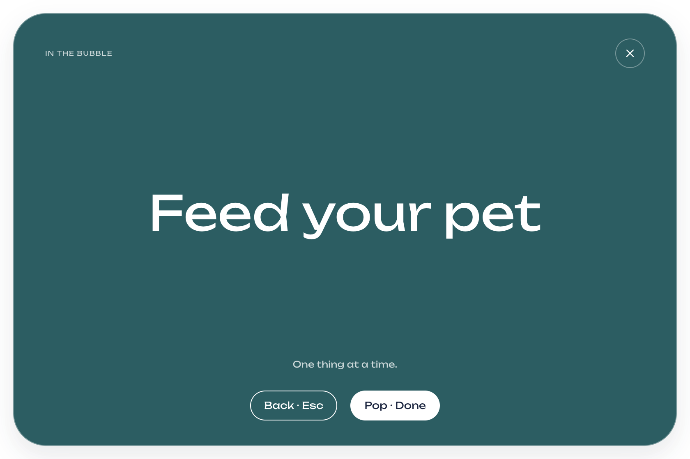

# TODOPOP 0.3.1：UI 细节修复

日期：2026-10-23。

## 修改

- O 上的加号、归档与配色符号改用统一 SVG。图标按实际椭圆区域居中，不再依赖字体基线。帮助、关闭、删除按钮同时统一几何居中；Group 的 Done / Close 右对齐。
- 教程（Quick tour）移入白色卡片，修复原先透明背景与其他面板叠放的问题。新增、归档、配色、连接、教程使用同一面板状态；每次切换替换前一个面板，内容滚动位置重置。
- 色环外径保持原设计 150 CSS px，内孔从外径的 45% 改回原 Figma 资源的 55%，环带变细。Tint 与自定义分组色在拖动中持续提交；每帧合并指针事件，并只保留一个进行中的提交和最新待提交值，避免请求不断排队。
- Focus billboard 改为随主题变化的深色背景、白色任务标题、浅色辅助文字与可读按钮。教程中的 Focus 示例也采用深底浅字。
- plain 白色椭圆 Dock、移动、位置记忆和原有气泡手势保持。

## 验证

专项测试 `node scripts/ui-polish.mjs` 覆盖：

- 三个 O 图标相对椭圆的中心偏差小于 0.5 CSS px。
- 教程与全部 Dock 面板互相切换，任一时刻只有一块主面板；教程底色不透明。
- 指针仍按住时连续两次改变 Tint，确认持久化状态和实际主题均已更新；分组色同样在松手前更新。
- 色环内孔比例为 55%；Focus 使用白字、深底，返回操作有效；零 renderer 错误。

完整验证、逐步日志与耗时见 [测试结果](test-results/summary.json)。测试使用临时数据目录，没有操作真实任务。

## 人工复核

- [ ] 在自己的显示器缩放下看三个 O、位置箭头、删除按钮是否协调。
- [ ] 依次打开教程 → 配色 → 新增 → 归档，检查只显示当前面板。
- [ ] 连续拖动色环和饱和度条，观察实际气泡、文字是否跟随更新。
- [ ] 单击无链接任务，确认深底白字 Focus 的观感及长标题阅读效果。

0.3.1 为 Apple Silicon 本地预览，尚未通过 Apple 公证；安装前退出旧版。
